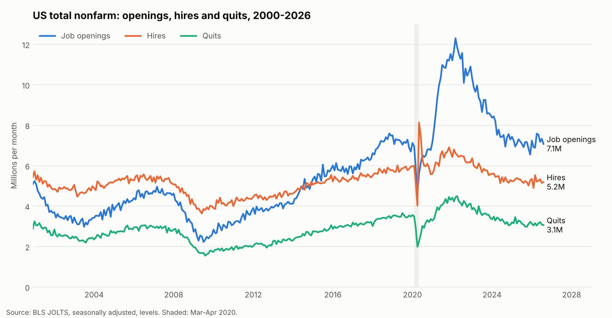

# Are job openings turning into hires? A JOLTS forecast

Forecasts **hires per opening** (hires / job openings) 6 months ahead for total nonfarm and finance and insurance, tests it against simple baselines, and turns it into a hiring-plan scenario for a hypothetical company.

**Read first:** [brief.md](brief.md) (one page, for a recruiting or workforce-planning lead).

## Result in one paragraph
A standard time-series model barely beats "same as now" for total nonfarm (error 0.030 vs 0.032) and ties a 12-month average for finance and insurance (0.107 vs 0.107). The useful output is the range: for 100 hires a month, a finance and insurance team needs between about 209 and 378 open roles depending on where the ratio lands.

## Data
- Source: BLS JOLTS flat files, https://download.bls.gov/pub/time.series/jt/
- Files used: `jt.data.1.AllItems` and `jt.series`
- Downloaded: Nov 1, 2026 (latest month: Aug 2026). BLS revises past months, so re-downloading later gives slightly different numbers.
- National and industry level only. No employer-level data.
- Cleaned output: `data/jolts_clean.csv` (seasonally adjusted, monthly, 6 industries, levels in thousands and rates in percent).

## How to reproduce (the SOP)
1. Download the two BLS files into `data/raw/`. Note the date.
2. `pip install -r requirements.txt`
3. Clean: `python scripts/clean_jolts.py data/raw data/jolts_clean.csv`
4. Check: Aug 2026 total nonfarm should show openings 7,079, hires 5,192, total separations 5,070, quits 3,066 (thousands), matching the BLS release. If you re-download later, check against that month's release instead.
5. Chart: `python scripts/plot_jolts.py data/jolts_clean.csv results/jolts_total_nonfarm.png`
6. Baselines: `python scripts/baseline.py data/jolts_clean.csv results/baseline_backtest.csv`
7. Model: `python scripts/better_model.py data/jolts_clean.csv results/baseline_backtest.csv results/model_backtest.csv`
8. Scenarios: `python scripts/scenario.py data/jolts_clean.csv results/scenario_costing.csv`
9. Update the numbers in `brief.md` from the new results.

## Method
- **Target:** hires per opening. Higher means openings convert to hires more easily.
- **Backtest:** rolling origin. For each of the last 36 months with a full 6-month horizon, forecast using only earlier data and compare to what happened. Score is mean absolute error.
- **Baselines:** same as now; average of the last 12 months.
- **Model:** damped-trend exponential smoothing on log hires and log openings, forecast separately and divided. Run raw and with a 3-month rolling median smooth.
- **Scenarios:** 100 hires a month, open roles needed = 100 / ratio. Ratios: now, model forecast, forecast plus or minus the backtest error, the lowest ratio in 2022-23, and the 2000-2019 average.

## Assumptions and limits
- The company is hypothetical. The $10,000 cost per open role per month in `scenario_costing.csv` is an assumption, not data.
- A low ratio means openings aren't turning into hires; it does not prove roles are hard to fill.
- The same test window compared two model variants, so small gaps are not strong evidence.
- Finance and insurance monthly data is noisy (e.g. Dec 2025 openings of 129k vs roughly 300k nearby).
